# Laboratory Report 1: Designing Smart Things

**Date:** 10/28/2026  
**Authors:** Lahashinejad Moein, Bach Quyen, Le Minh, Behazin Navid  
**Institution:** HAMK (Häme University of Applied Sciences)  

---

## Contents
1. [Objectives](#1-objectives)
2. [Theory, Pre-Lab Work](#2-theory-pre-lab-work)
   - [2.1 Theoretical Fundamentals](#21-theoretical-fundamentals)
   - [2.2 Pre-Lab Preparation](#22-pre-lab-preparation)
3. [Equipment, Materials, Methods](#3-equipment-materials-methods)
   - [3.1 Equipment and Software Specifications](#31-equipment-and-software-specifications)
   - [3.2 Task 1: WSL2 and Ubuntu 24.04 Environment Setup](#32-task-1-wsl2-and-ubuntu-2404-environment-setup)
   - [3.3 Task 2: PX4 Autopilot and Gazebo Harmonic Installation](#33-task-2-px4-autopilot-and-gazebo-harmonic-installation)
   - [3.4 Task 3: Start the X500 in Baylands](#34-task-3-start-the-x500-in-baylands)
   - [3.5 Task 4A: QGroundControl Dependencies and Environment Setup in WSL](#35-task-4a-qgroundcontrol-dependencies-and-environment-setup-in-wsl)
   - [3.6 Task 4B: Downloading the Stable QGroundControl AppImage](#36-task-4b-downloading-the-stable-qgroundcontrol-appimage)
   - [3.7 Task 4C: Launching QGroundControl via WSLg](#37-task-4c-launching-qgroundcontrol-via-wslg)
   - [3.8 Task 4D: Confirming Automatic Vehicle Detection](#38-task-4d-confirming-automatic-vehicle-detection)
   - [3.9 Task 4E: Troubleshooting and Manual UDP Link Configuration](#39-task-4e-troubleshooting-and-manual-udp-link-configuration)
   - [3.10 Task 4F: Troubleshooting QGroundControl Startup and AppImage Execution](#310-task-4f-troubleshooting-qgroundcontrol-startup-and-appimage-execution)
   - [3.11 Task 5: Try Takeoff and Landing](#311-task-5-try-takeoff-and-landing)
   - [3.12 Task 6: Fly a Short Waypoint Mission](#312-task-6-fly-a-short-waypoint-mission)
   - [3.13 Task 7: Stop and Restart the Environment](#313-task-7-stop-and-restart-the-environment)
4. [Conclusions](#5-conclusions)

---

## 1 Objectives

The objective of this laboratory exercise is to establish and validate a complete Software-In-The-Loop (SITL) simulation framework for autonomous unmanned aerial vehicle (UAV) operations. Specifically, the experiment focuses on setting up the Windows Subsystem for Linux (WSL2) environment, configuring the PX4 Autopilot flight stack alongside the Gazebo Harmonic physics simulator, and integrating the QGroundControl (QGC) ground control station. Furthermore, the workflow covers deploying realistic environmental models (Baylands), executing pre-flight checks, performing basic vertical flight commands (takeoff, hover, and landing), and planning and executing autonomous waypoint navigation missions. Expected outcomes include verifying stable telemetry synchronization, successful real-time simulation rendering, and reliable execution of autonomous flight paths without hardware constraints.

---

## 2 Theory, pre lab work

This section outlines the theoretical concepts and software architectures underlying the autonomous UAV simulation framework, along with the preliminary setup required prior to executing the laboratory tasks.

### 2.1 Theoretical Fundamentals

*   **Software-In-The-Loop (SITL) Simulation:** SITL allows the complete PX4 flight control stack to execute directly on the host computer's processor without physical flight hardware. The firmware processes simulated sensor inputs (IMU, GPS, barometer) and outputs motor control commands to a physics engine in real time.
*   **Physics & Environmental Modeling:** The Gazebo Harmonic simulator models rigid-body dynamics, aerodynamics, gravity, and collisions for the Holybro X500 quadcopter. Real-world environmental factors, including complex terrain and surface textures, are emulated through Gazebo Fuel asset models such as the Baylands park world.
*   **Telemetry and Communication Protocols:** Inter-process communication between PX4, Gazebo, and QGroundControl relies on the MAVLink protocol. MAVLink packages vehicle state metrics, telemetry data, and mission commands over local UDP network sockets (e.g., listening on port 14550).
*   **Linux Virtualization via WSL2 and WSLg:** To bridge cross-platform dependencies, Windows Subsystem for Linux (WSL2) provides a native Linux kernel execution environment within Windows 11. WSLg enables direct Wayland/X11 graphical window pass-through for rendering user interfaces seamlessly on the Windows desktop.

### 2.2 Pre-Lab Preparation

Prior to conducting the laboratory session, the necessary software repositories, system dependencies, and environment parameters were audited:
1. Verifying virtualization support and updating the host operating system to support WSL2 architecture.
2. Reviewing PX4 Autopilot architecture documentation, command-line interfaces (e.g., `pxh>` shell), and MAVLink UDP network mapping guidelines.
3. Inspecting hardware requirements to ensure adequate system memory and GPU resources for concurrent execution of PX4, Gazebo, and QGroundControl.

---

## 3 Equipment, materials, methods

This section outlines the software tools, virtualization environments, and simulation components deployed to establish and execute the drone flight testing framework. To perform the simulation of the Holybro X500 quadcopter within the Baylands environment, a complete Software-In-The-Loop (SITL) architecture was deployed on a host computer. No physical hardware components, external controllers, or actual airframes were required, as all operations were fully emulated through software. The setup integrates a Linux subsystem running within Windows, a dedicated physics and 3D environment simulator, an autopilot flight stack, and a ground control station.

### 3.1 Equipment and Software Specifications

| Category | Component / Tool | Role and Function in the Experiment |
| :--- | :--- | :--- |
| **Host Hardware & OS** | Windows 11 Laptop | Primary host machine executing the virtualization layer and graphical interface via WSLg. |
| | Internet Access | Required for downloading dependencies, PX4 repositories, Baylands 3D models, and map tiles. |
| | HP ZBook Studio 16 G10 Laptop | Primary host machine executing the virtualization layer, physics simulation, and graphical interface via WSLg. |
| **Virtualization & OS Environment** | WSL2 (Windows Subsystem for Linux) | High-performance virtualization layer running the Linux kernel natively on Windows 11. |
| | Ubuntu 24.04 LTS | Linux distribution operating environment executing all simulation software and flight stacks. |
| | WSLg | Provides seamless GUI window integration from Ubuntu to the Windows desktop. |
| **Flight Control & Simulation Stack** | PX4 Autopilot (SITL) | Runs the PX4 flight control software in Software-In-The-Loop (SITL) mode on the host PC. |
| | Gazebo Simulator | 3D robotics simulator rendering physics, sensors, collision, and the flight environment. |
| **Ground Station & Simulation Assets** | QGroundControl (QGC) | Ground Control Station (GCS) AppImage providing telemetry monitoring, vehicle status, and mission planning. |
| | Holybro X500 Model | Simulated quadcopter vehicle model (camera-free variant to optimize computational load). |
| | Baylands World Model | 3D scenery and terrain environment representing Baylands Park in Sunnyvale, California. |

### 3.2 Task 1: WSL2 and Ubuntu 24.04 Environment Setup

The initial phase of the laboratory implementation focused on establishing a robust Linux execution environment on the Windows 11 host operating system utilizing the Windows Subsystem for Linux (WSL2). The procedure was structured into the following sequential steps:

1.  **WSL and Distribution Installation:** Using an administrator-privileged Windows PowerShell interface, the virtualization subsystem and the target Linux distribution were deployed by executing the installation command for Ubuntu 24.04 LTS.
   
   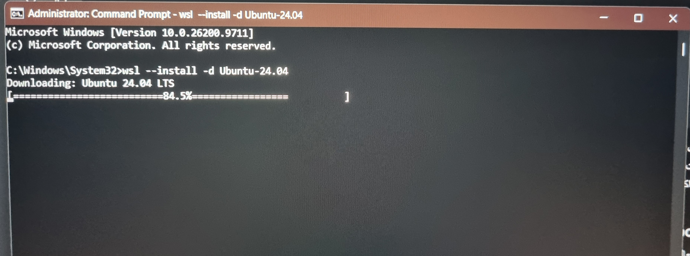
2.  **User Account Configuration:** Upon the successful provisioning of the WSL instance, a default UNIX user account and a secure password were established within the terminal interface to initialize the operating environment.
   
   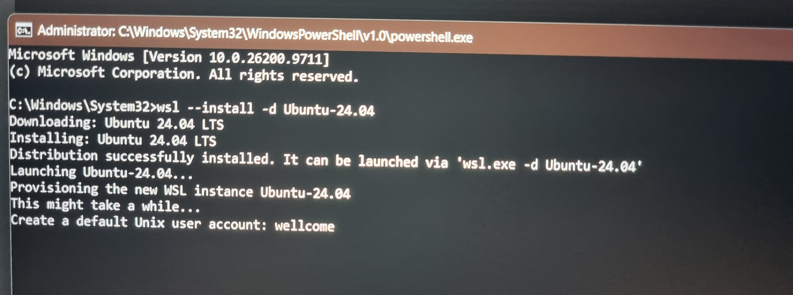
3.  **Environment Version Validation (Checkpoint 1):** To verify that the virtualization layer was operating under the optimized second-generation architecture, the WSL subsystem was updated and queried using the command-line interface. Verification confirmed that the Ubuntu-24.04 distribution was correctly registered and running under WSL version 2.
   
   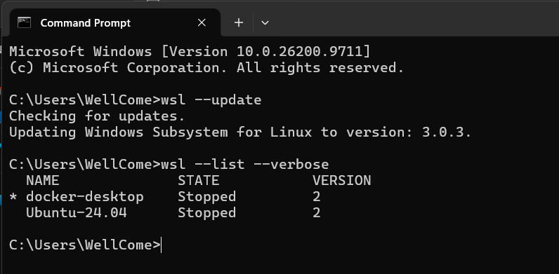

### 3.3 Task 2: PX4 Autopilot and Gazebo Harmonic Installation

To establish the core flight simulation capabilities, the PX4-Autopilot software suite and Gazebo Harmonic physical simulator were installed within the local Ubuntu environment. The implementation followed these structured steps:

1.  **Source Code and Submodule Acquisition:** The official PX4-Autopilot repository was cloned into the Linux home directory (`~`) along with its required submodules using recursive retrieval:
    ```bash
    cd ~
    git clone --recursive https://github.com/PX4/PX4-Autopilot.git
    ```

    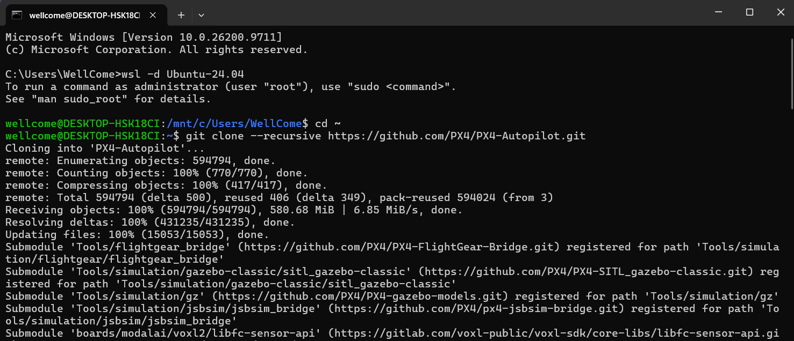
2.  **Automated Toolchain Deployment:** The environment setup script was executed to resolve and install all build dependencies, compiler chains, and the Gazebo simulator framework:
    ```bash
    cd ~/PX4-Autopilot
    bash ./Tools/setup/ubuntu.sh
    ```

   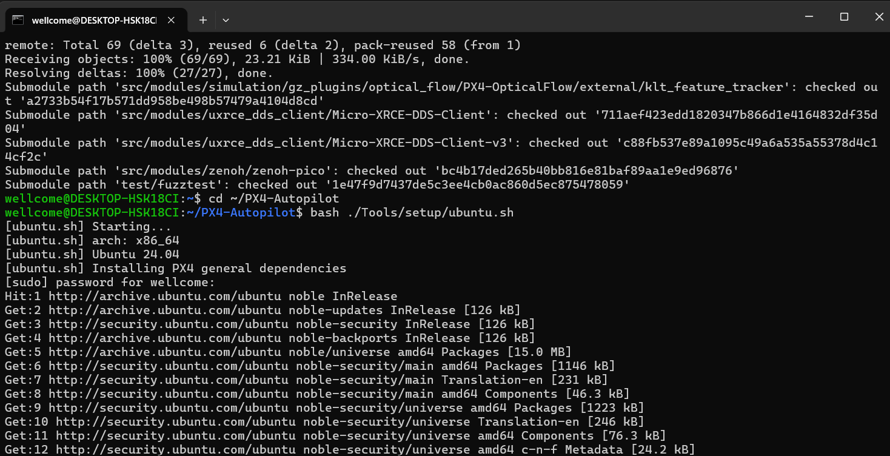
3.  **Subsystem Reset and Version Verification:** Following the execution of the setup script, the WSL instance was restarted from Windows PowerShell (`wsl --shutdown`) to apply new environment variables. After reopening Ubuntu 24.04, system revisions were recorded for documentation and repeatability:
   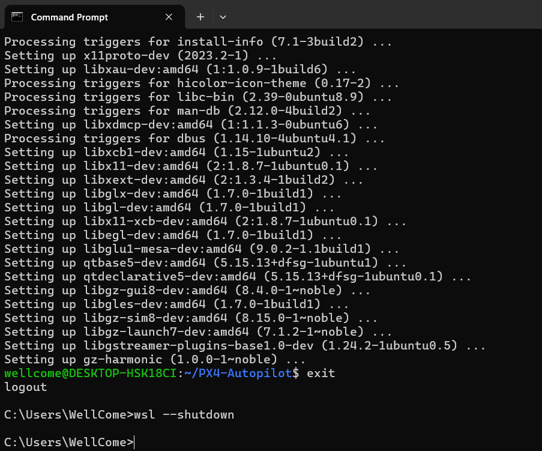

   ```bash
    cd ~/PX4-Autopilot
    git rev-parse HEAD
    git submodule status
    gz sim --versions
```

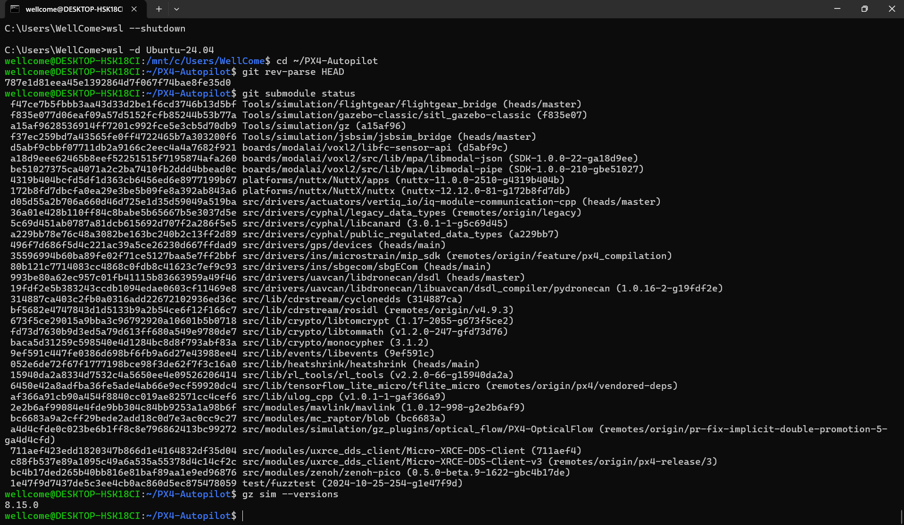

4.  **Baseline Simulation Verification (Checkpoint 2):** To verify system integrity prior to complex environment configurations, a baseline SITL (Software-in-the-Loop) flight simulation was initialized for the Holybro X500 drone frame:
    ```bash
    make px4_sitl gz_x500
    ```
    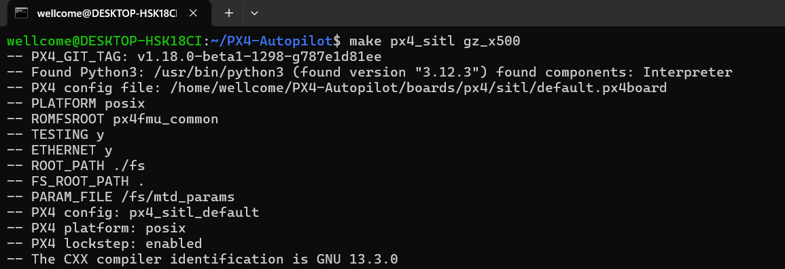

    The build pipeline compiled the PX4 firmware target and successfully launched the Gazebo graphical environment alongside the PX4 console prompt (`pxh>`).

    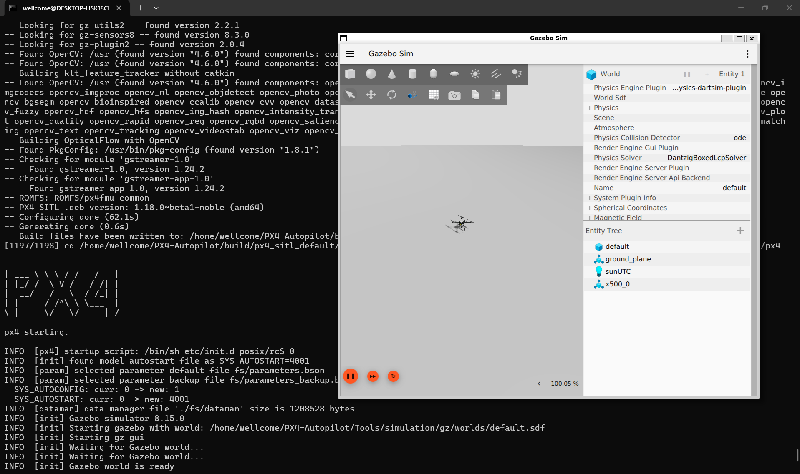

### 3.4 Task 3: Start the X500 in Baylands

To evaluate the flight control system within a complex, realistic environment, the simulation was transitioned from the default flat plane to the Baylands coastal scenery. The implementation followed these structured procedures:

1.  **World File Verification:** The local workspace was inspected to verify that the required `baylands.sdf` world file was present within the simulation package directories:
    ```bash
    cd ~/PX4-Autopilot
    find Tools/simulation/gz -type f -name baylands.sdf
    ```
2.  **Scenery and Asset Acquisition:** The required scenery models for the Baylands landscape and coastal water physics were downloaded from the Gazebo Fuel server using the following commands:
    ```bash
    gz fuel download -u https://fuel.gazebosim.org/1.0/OpenRobotics/models/baylands
    gz fuel download -u "https://fuel.gazebosim.org/1.0/OpenRobotics/models/Coast Water"
    ```
3.  **Baylands Simulation Initialization:** To launch the simulation in the target environment, default autopilot autostart variables were cleared, and the World variable was explicitly set to `baylands`:
    ```bash
    cd ~/PX4-Autopilot
    unset PX4_SYS_AUTOSTART PX4_GZ_MODEL_NAME PX4_GZ_STANDALONE
    PX4_GZ_WORLD=baylands make px4_sitl gz_x500
    ```

    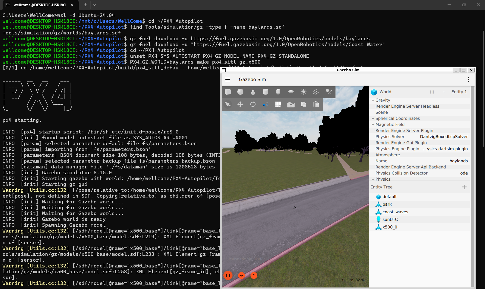
    
    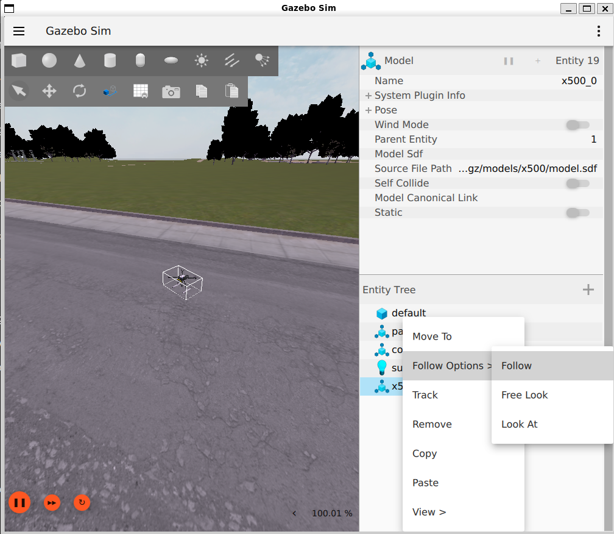

5.  **Entity Tracking and Topic Verification (Checkpoint 3):** Once the Gazebo graphical interface loaded the scenery, the Entity Tree panel was accessed to select the `x500_0` model, and the Follow mode was enabled to lock the observer camera onto the drone. Furthermore, active simulation topics were introspected from a secondary WSL terminal:
    ```bash
    gz topic -l
    ```

   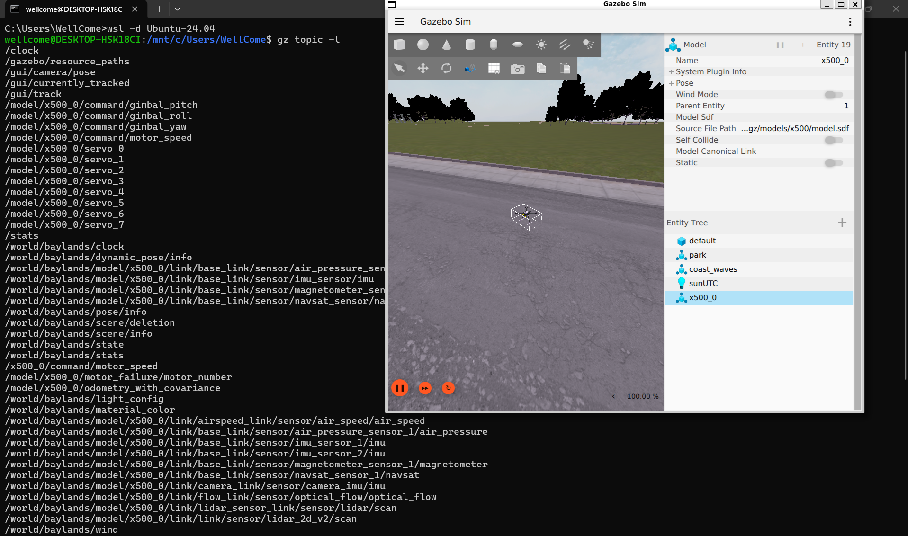

### 3.5 Task 4A: QGroundControl Dependencies and Environment Setup in WSL

To establish ground control station capabilities within the Ubuntu WSL2 environment, required application packages, graphical libraries, and multimedia dependencies were installed using the following structured procedure:

1.  **System Repository Update:** The local package index was synchronized to ensure all installation sources were up to date:
    ```bash
    sudo apt update
    ```
2.  **AppImage Integration Package Installation:** The `libfuse2t64` package (required for executing AppImage application bundles on Ubuntu 24.04) alongside the `wget` utility was installed:
    ```bash
    sudo apt install -y wget libfuse2t64
    ```

   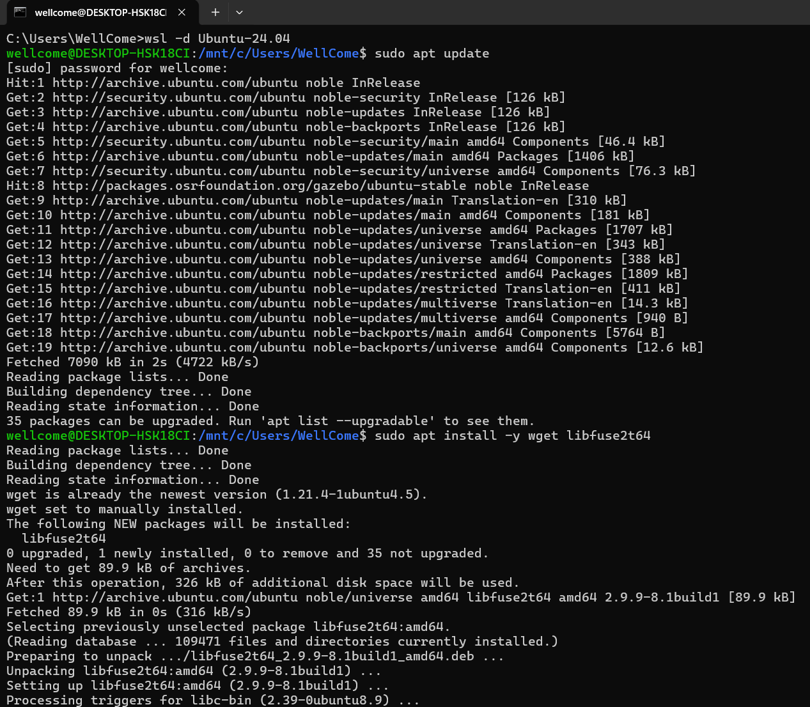

3.  **Graphical and Window System Libraries Deployment:** Essential X11 protocol and window cursor dependencies required by the Qt-based QGroundControl user interface were deployed:
    ```bash
    sudo apt install -y libxcb-xinerama0 libxkbcommon-x11-0 libxcb-cursor0
    ```

4.  **Multimedia and Video Streaming Framework Integration:** GStreamer multimedia plugins and libraries were installed to support real-time video streaming telemetry from the drone:
    ```bash
    sudo apt install -y gstreamer1.0-plugins-bad gstreamer1.0-libav gstreamer1.0-gl
    ```
   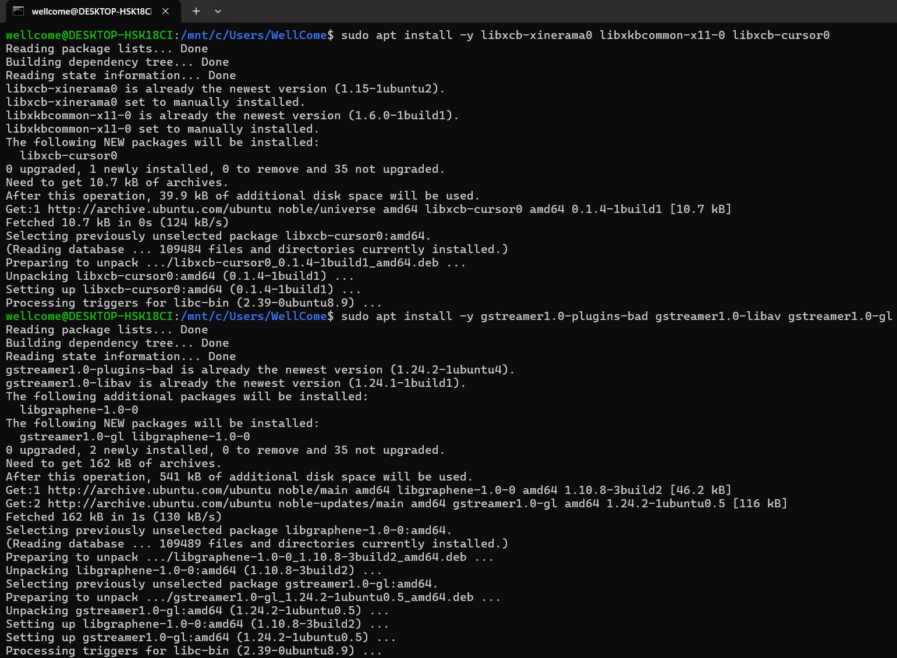

### 3.6 Task 4B: Downloading the Stable QGroundControl AppImage

To obtain the Linux executable for the ground control station, a dedicated directory was created within the user environment, and the stable AppImage release was retrieved using the following steps:

1.  **Directory Creation and Navigation:** A structured workspace directory named `QGroundControl` was initialized to store the executable binary:
    ```bash
    mkdir -p ~/QGroundControl
    cd ~/QGroundControl
    ```
2.  **AppImage Asset Retrieval:** The official Linux release of QGroundControl was downloaded using `wget` directly into the newly created folder:
    ```bash
    wget -O QGroundControl-x86_64.AppImage "https://d176tv9ibo4jno.cloudfront.net/latest/QGroundControl-x86_64.AppImage"
    ```
   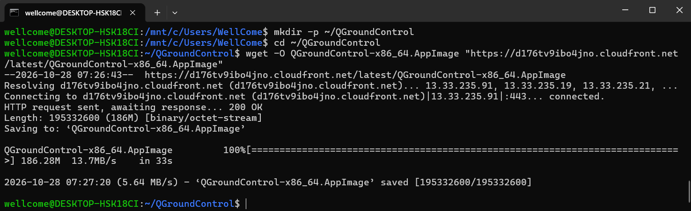


### 3.7 Task 4C: Launching QGroundControl via WSLg

To initialize the ground control station interface within the WSL environment, executable permissions were granted to the AppImage binary, and the application was launched using the standard user session:

1.  **Granting Executable Permissions:** The `chmod` utility was utilized to set the execution flag on the downloaded AppImage package:
    ```bash
    chmod +x ~/QGroundControl/QGroundControl-x86_64.AppImage
    ```
2.  **Application Execution:** The QGroundControl application was initiated directly from the terminal without administrative (`sudo`) privileges, leveraging WSLg for graphical user interface rendering on the Windows desktop:
    ```bash
    ~/QGroundControl/QGroundControl-x86_64.AppImage
    ```
    
   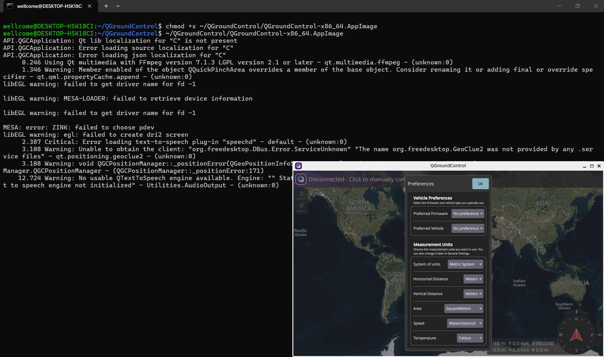  

### 3.8 Task 4D: Confirming Automatic Vehicle Detection

To verify the communication link and telemetry synchronization between the simulation environment and the ground control station, the following procedure was executed:

1.  **Simulation Launch:** The PX4 Software-In-The-Loop (SITL) simulation was initialized with the standard quadrotor model in the workspace terminal:
    ```bash
    make px4_sitl gz_x500
    ```
2.  **Telemetry and Interface Verification:** With both Gazebo Harmonic and QGroundControl running concurrently, the QGC interface automatically established a UDP connection, recognized the simulated vehicle (`x500_0`), downloaded the necessary parameters, and displayed the aircraft's position and status within the Flight View map interface.

 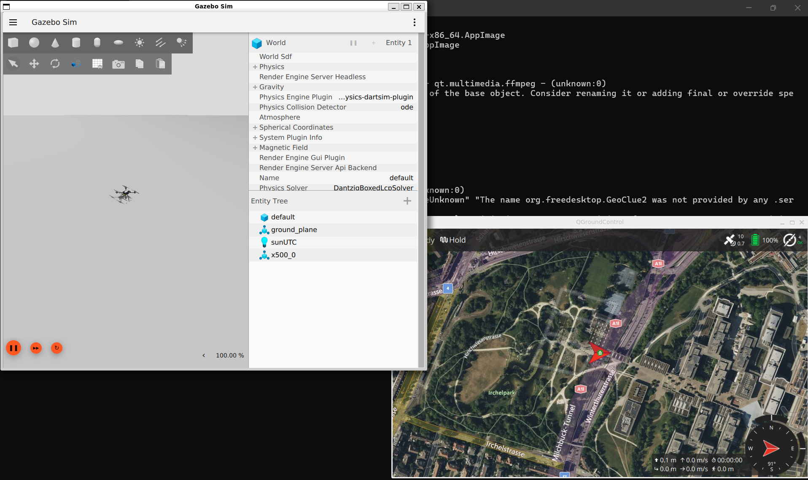

### 3.9 Task 4E: Troubleshooting and Manual UDP Link Configuration

In scenarios where the simulation vehicle is not automatically detected by QGroundControl, a manual UDP communication link must be established:

1.  **Accessing Application Settings:** Within QGroundControl, navigate to **Application Settings** and select the **Comm Links** tab.
2.  **Adding a Custom UDP Link:** A new link was configured using the parameters specified in the documentation to ensure robust communication between the local WSL environment and the ground station:
    *   **Name:** Local WSL simulation
    *   **Type:** UDP
    *   **Listening Port / Port:** 14550
    *   **Server Addresses:** `127.0.0.1:18570`
    *   **High Latency:** Off
3.  **Connection Finalization:** The link was saved and connected to bind QGC to the local loopback interface (`127.0.0.1`) listening on port 14550, overriding any potential auto-discovery issues.

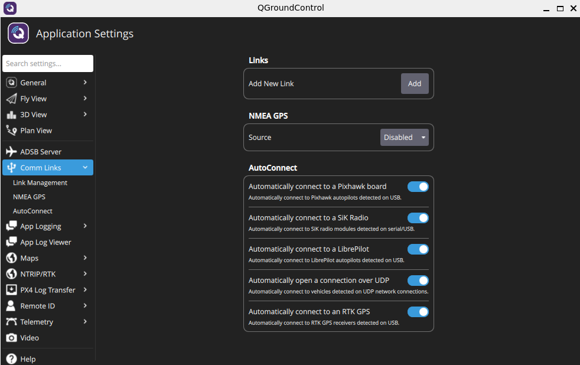

### 3.10 Task 4F: Troubleshooting QGroundControl Startup and AppImage Execution

In the event that QGroundControl fails to launch due to missing dependencies, graphical backend issues, or FUSE-related restrictions within the Linux environment, a robust fallback execution method was documented:

1.  **Alternative Execution via AppImage Extraction:** To bypass FUSE mounting errors and force application startup without standard root-level mounts, the following command was prepared for execution in the terminal:
    ```bash
    ~/QGroundControl/QGroundControl-x86_64.AppImage --appimage-extract-and-run
    ```
2.  **Version and Readiness Verification:** As per the checkpoint requirements, the application status was validated to ensure a reliable telemetry link, valid position tracking, and accurate flight readiness indicators before proceeding to active flight missions.

### 3.11 Task 5: Try takeoff and landing

To execute an autonomous flight mission using the PX4 SITL simulation environment paired with Gazebo and QGroundControl, the following structured procedure was followed:

1.  **Environment Preparation:** QGroundControl and Gazebo Sim were arranged side-by-side. In the QGC Fly view, the map was centered on the simulated vehicle position, and pre-flight readiness messages were reviewed to ensure the system reached the `Ready for takeoff!` state.
2.  **Flight Command Execution:** Using the PX4 console prompt (`pxh>`) within the launch terminal as a reliable fallback method, commands were executed sequentially without batching:
    *   **Takeoff:** The system status was checked via `commander status`, followed by issuing `commander takeoff` to trigger internal arming and climb to the default altitude.
    *   **Hover Observation:** The vehicle was allowed to settle into a stable hover state for approximately 10 seconds while monitoring altitude and armed states.
    *   **Landing Sequence:** The landing command `commander land` was executed to initiate vertical descent, touchdown, and automatic motor disarming.
  
   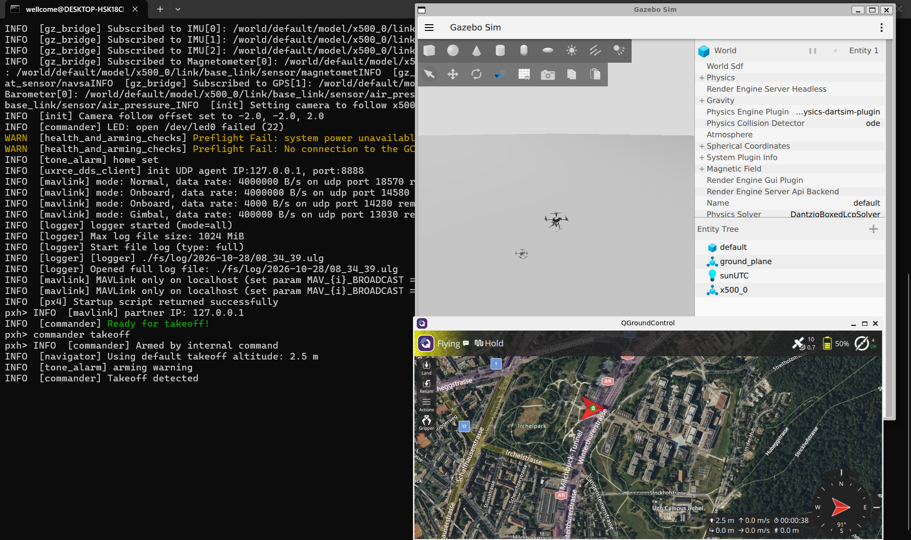

   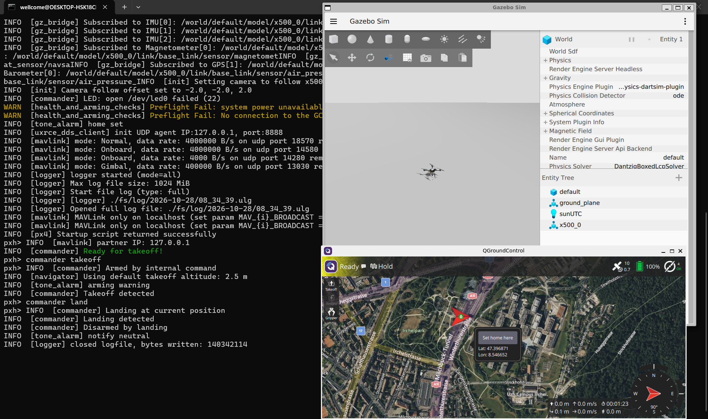
      
   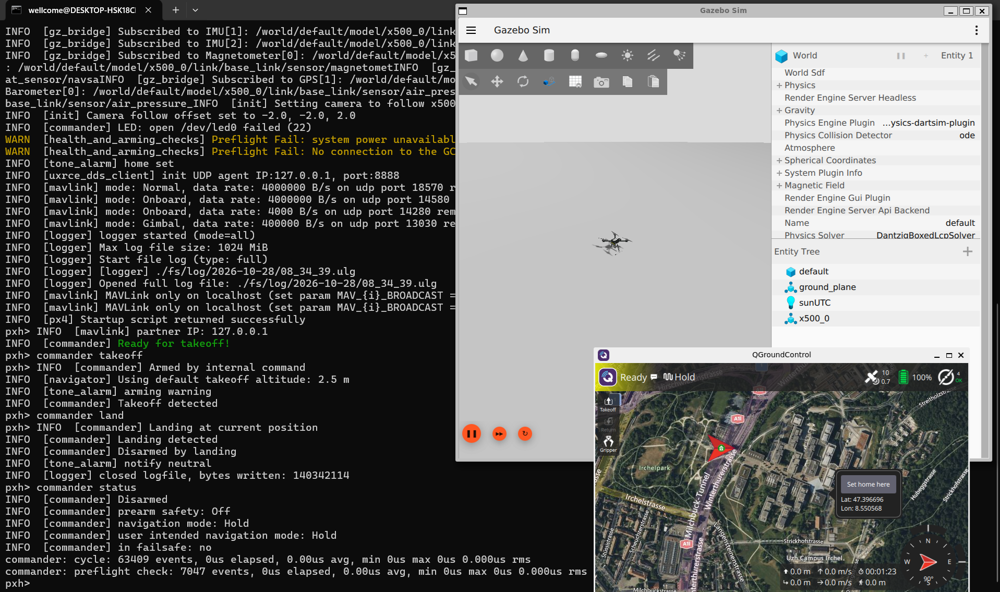

### 3.12 Task 6: Fly a short waypoint mission

To execute the autonomous waypoint navigation mission using the PX4 SITL and Gazebo simulation environment, the following step-by-step procedure was implemented:

1.  **Environment Initialization:**
    *   The PX4 SITL simulation coupled with the x500 quadcopter model was launched within the Gazebo Sim 3D environment (utilizing the baylands world) via the WSL terminal.
    *   QGroundControl (QGC) was initiated to establish a telemetry and command link with the simulation via the MAVLink protocol.
2.  **Waypoint Mission Planning (Plan View):**
    *   Upon switching to the Plan View in QGC and defining the Home Position on the map, a Takeoff waypoint was designated with a safe altitude set to prevent environmental obstacles such as trees.
    *   A sequence of navigation Waypoints was strategically placed along a predefined route over the map.
    *   A Return-to-Launch (RTL) command was appended at the final stage of the route to ensure automated return and landing.
    *   The mission plan was saved (`Baylands First Mission.plan`) and successfully uploaded to the vehicle using the Upload interface.
3.  **Autonomous Mission Execution (Fly View):**
    *   After verifying the successful upload, the interface was switched to the Fly View.
    *   The autonomous mission was initiated by triggering the Start Mission command, prompting the vehicle to execute the planned trajectory automatically.
  


### 3.13 Task 7: Stop and Restart the Environment

To properly shut down and restart the simulation environment between sessions, the following standard procedure was followed:

1.  **Environment Termination:**
    *   After completing the flight missions, QGroundControl (QGC) was closed.
    *   The PX4 simulation was terminated in the launch terminal using the `Ctrl+C` command, and all remaining Gazebo windows were closed.
2.  **Session Restart and Reconnection:**
    *   For subsequent sessions, Windows PowerShell was used to access the Ubuntu WSL distribution (`wsl -d Ubuntu-24.04`).
    *   The PX4 SITL simulation with the Baylands world was re-launched from the first terminal (`make px4_sitl gz_x500`), while Linux QGC was initiated from a second terminal.
    *   Finally, vehicle tracking was re-enabled in Gazebo (`x500_0 -> Follow`) to re-establish the telemetry link with QGC.

---

## 5 Conclusions

This laboratory experiment successfully demonstrated the end-to-end implementation and validation of an autonomous UAV flight testing environment using a Software-In-The-Loop (SITL) architecture. By integrating PX4 Autopilot, Gazebo Harmonic, and QGroundControl within a Windows Subsystem for Linux (WSL2) framework, a robust cross-platform simulation pipeline was established without requiring physical flight hardware.

Key milestones achieved during the lab include:

1.  **System Integration & Environment Setup:** Successfully deployed Ubuntu 24.04 on WSL2, verified system dependencies, and launched both baseline and complex 3D environments (Baylands) with full telemetry synchronization over MAVLink.
2.  **Ground Control & Telemetry Verification:** Configured QGroundControl to interface with the PX4 SITL stack, establishing reliable auto-detection and manual UDP communication links for real-time monitoring and command execution.
3.  **Autonomous Flight & Waypoint Navigation:** Executed fundamental vertical flight maneuvers (takeoff, hover, landing) and planned, uploaded, and autonomously executed a complete multi-point waypoint mission. The mission verified precise altitude control, terrain hazard avoidance, and reliable Return-to-Launch (RTL) capabilities.

In conclusion, the experiment verified that the SITL-based virtual development framework provides an effective, repeatable, and safe platform for testing drone flight algorithms, mission planning procedures, and ground control integration prior to real-world deployment.
